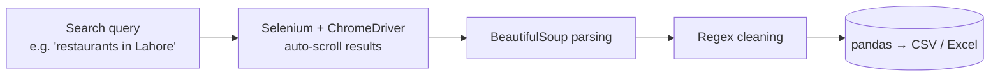

# 🗺️ BRIHA · Google Maps Data Mining


    

> ⚡ **Part of [BRIHA](https://github.com/asad110abbas)** · Briha Research, built by Syed Asad Abbas.

Automated **lead-generation scraper** that collects business listings from Google Maps search results
(name, rating, reviews, address, phone, website) and exports them as a clean dataset.

## Pipeline


## Highlights
- **Headless browser automation** with Selenium and `webdriver-manager` (no manual driver setup)
- **Infinite-scroll handling** to load every result, with polite delays
- **Robust parsing** with BeautifulSoup and regex for phone numbers, ratings and review counts
- **Analysis-ready output** as a pandas DataFrame exported to CSV / Excel

## Run
```bash
pip install selenium webdriver-manager beautifulsoup4 pandas requests
```
Open `Google_Map_Data_Mining.ipynb`, set your search query and run all cells. Chrome must be installed.

> Use responsibly and respect the website's terms of service and rate limits.
